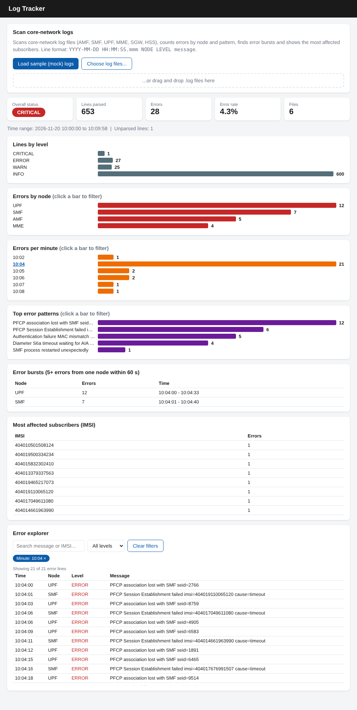

# Log Tracker

A small Python tool for 4G/5G core-network log analysis. It scans log files from nodes such as
AMF, SMF, UPF, MME, SGW and HSS and shows:

- lines by level (CRITICAL / ERROR / WARN / INFO) and an overall status (HEALTHY / DEGRADED / CRITICAL)
- errors by node, errors per minute and the most common error patterns
  (IDs and numbers are replaced, so similar errors are grouped as one problem)
- error bursts: 5 or more errors from one node within 60 seconds
- the subscribers (IMSI) most affected by errors
- an error explorer: click a bar to filter the list, or search the messages

It works as a **local web app** and as a **command-line tool**.
The sample logs are **mock logs** made by `generate_mock_logs.py` with a few planted incidents
(a PFCP association loss on the UPF, Diameter timeouts, authentication failures, an SMF restart).


## Web app
```bash
python app.py                 # opens http://127.0.0.1:8000
```
Click **Load sample (mock) logs**, or upload / drag in your own `.log` files.
Only the Python standard library is needed; the server listens on your computer only.

## Command line
```bash
python generate_mock_logs.py                         # creates logs/*.log
python log_tracker.py logs/                          # print the summary report
python log_tracker.py logs/ --report report.txt --csv errors.csv --html report.html
```
The exit code is 1 when a CRITICAL line is found, so it can be used in scripts.

## Log format
`YYYY-MM-DD HH:MM:SS.mmm NODE LEVEL message` - lines that do not match are counted as "unparsed".

## Tests
```bash
python -m pytest
```

## Files
- `log_tracker.py` - parsing, grouping, burst detection, report/CSV/HTML output
- `generate_mock_logs.py` - creates the mock logs
- `app.py` and `web/index.html` - the web app
- `tests/` - pytest tests

## Ideas for next steps
- Add a second regex for real node log formats
- Compare two runs to find new error patterns
